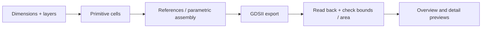

# GDS Layout Kit

**Compose parametric geometry in Python, export GDSII, and inspect a matching preview.**

[中文](README.zh-CN.md) · [Usage](docs/usage.md) · [API](docs/api.md) · [CLI](docs/cli.md) · [Visual gallery](docs/showcase/gallery.html)


This public sample contains three ring radii, rectangular pads and alignment crosses. The PNG is rendered from polygons read back from the accompanying [GDSII file](docs/showcase/parametric-sample.gds). It is illustrative geometry, with no fabrication or device-performance claim.

## What is included

- **Reusable cells:** pads, rings, alignment markers and polygonized labels.
- **Parametric layouts:** grating and metasurface builders with gradient transforms.
- **Export and inspection:** GDSII I/O, top-cell summaries and cropped PNG previews.
- **Scriptable workflow:** Python API, three CLI commands and pytest checks.

The toolkit uses `gdstk` for geometry and `matplotlib` for previews. It does not require a GUI layout editor.

## Quick start

Python **3.11+**. Declared runtime dependencies: `gdstk>=0.9`, `matplotlib>=3.7`.

```bash
python -m venv .venv
# Windows: .venv\Scripts\activate
# Linux/macOS: source .venv/bin/activate
python -m pip install -e ".[test]"
python examples/public_layout.py
```

The example creates `docs/showcase/parametric-sample.gds`, three PNG/SVG views and a [manifest](docs/showcase/manifest.json). All geometry comes from explicit generic parameters in [the example source](examples/public_layout.py); no external dataset is needed.

The original command-line demos remain available:

```bash
gds-layout-demo
gds-layout-gradient --layout-width-um 100 --layout-height-um 100
gds-layout-grating
```

See the [CLI reference](docs/cli.md) for options and the output directories of these commands.

## A small Python example

```python
from gds_layout_kit.assembly import build_demo_layout
from gds_layout_kit.io import write_gds, load_gds, top_cell_summary
from gds_layout_kit.preview import save_cell_preview

library, cells = build_demo_layout()
write_gds(library, "outputs/demo_layout.gds")
save_cell_preview(cells.top, "outputs/demo_layout.png", crop_fraction=1.0)
print(top_cell_summary(load_gds("outputs/demo_layout.gds")))
```

The library uses micrometre geometry units and a 10⁻¹¹ m GDS database precision. That is a coordinate quantization setting, not a statement about fabrication accuracy. The preview defaults to a **20% central crop**; request `crop_fraction=1.0` to see the whole layout.



## One file, three views

<table>
<tr><td></td><td></td></tr>
<tr><td>Detail crop: ring outer radius 8 µm, width 1.5 µm.</td><td>Parameter row: outer radii 4, 6 and 8 µm; pad 12 × 8 µm.</td></tr>
</table>

| Sample parameter | Value |
| --- | --- |
| Array | 3 ring columns × 4 rows, pitch 24 µm |
| Layers / datatypes | Pads 1/0 (blue), rings 2/0 (red), markers 3/0 (green) |
| Marker arm length / width | 14 / 2 µm |
| GDS units / precision | 10⁻⁶ m / 10⁻¹¹ m |
| Export checks | 6 cells, 20 top-cell references, 24 flattened polygons; matching bounds and area within quantization tolerance |

The generator reads the exported GDS before drawing every view, so the overview and zoom refer to the same file. It verifies polygon count, bounds and total area. These checks establish export consistency; manufacturing use still requires process-specific rules and independent DRC.

Recorded environment: Python 3.11.9, gds-layout-kit 0.1.0, gdstk 1.0.0, Matplotlib 3.10.9. [Source, parameters and file hashes](docs/showcase/manifest.json).

## Documentation and checks

[Usage guide](docs/usage.md) · [API reference](docs/api.md) · [CLI reference](docs/cli.md) · [Reproducible gallery](docs/showcase/gallery.html)

```bash
python -m pytest
```

`src/gds_layout_kit/` contains the library; `examples/` contains runnable scripts; `tests/` covers primitives, transforms, builders and GDS round trips.

## License

This repository currently has no license file or declared open-source license. Confirm permission before redistribution or incorporating it into another project.
