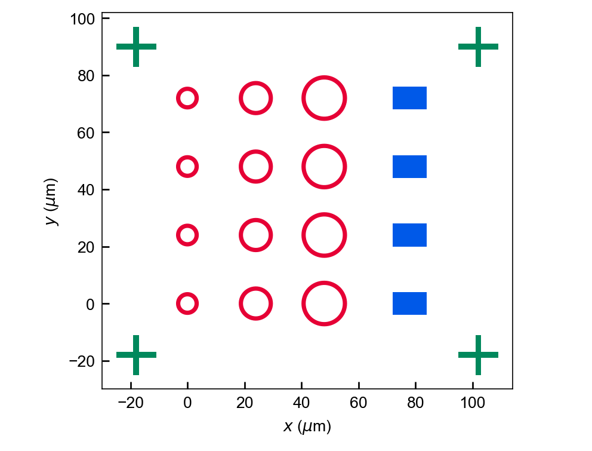
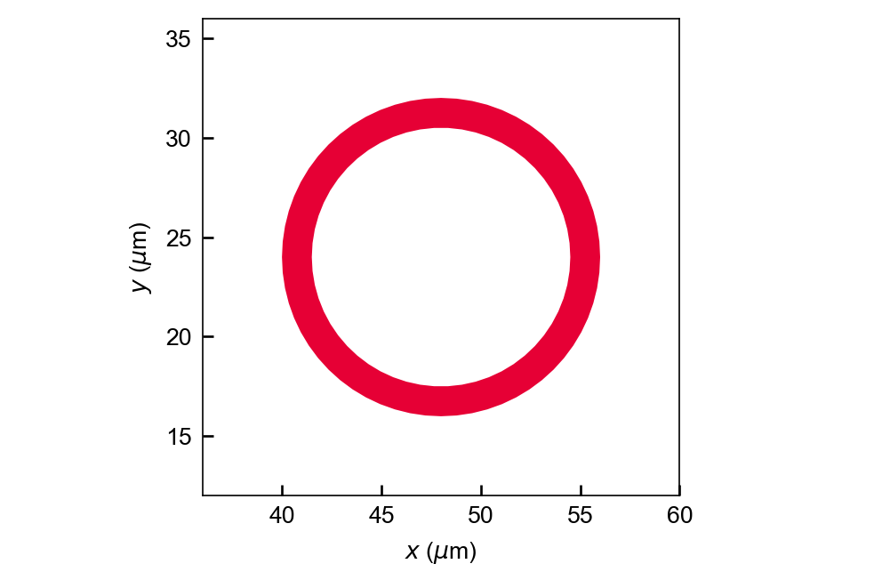
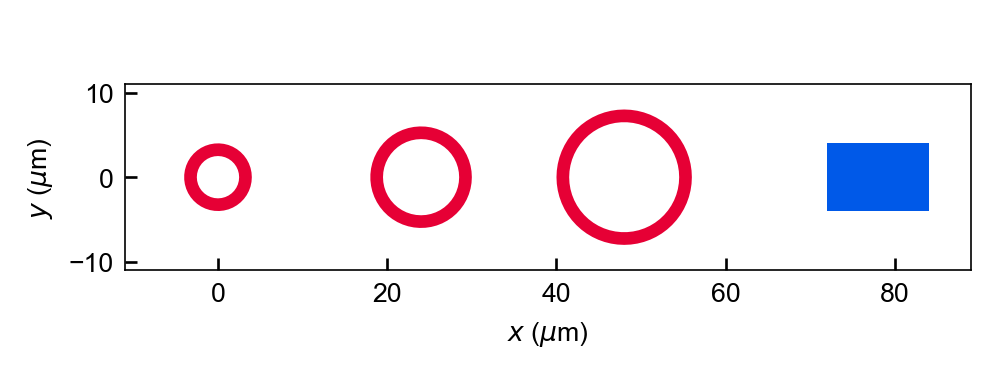

# GDS Layout Kit

**用 Python 组合参数化几何、导出 GDSII，并检查与文件一致的预览。**

[English](README.md) · [使用指南](docs/usage.md) · [API](docs/api.md) · [CLI](docs/cli.md) · [图集](docs/showcase/gallery.html)



公开演示包含三种半径的环、矩形 pad 和十字对准标记。PNG 来自配套 [GDSII 文件](docs/showcase/parametric-sample.gds)回读的多边形；它是几何示例，不包含工艺或器件性能结论。

## 已有功能

- **可复用 cell：** pad、圆环、对准标记与多边形文字。
- **参数化版图：** 光栅、超表面构建器及梯度坐标变换。
- **导出与检查：** GDSII 读写、顶层 cell 摘要及裁剪 PNG 预览。
- **脚本工作流：** Python API、三个 CLI 入口及 pytest 检查。

几何基于 `gdstk`，预览基于 `matplotlib`，不要求 GUI 版图编辑器。

## 快速开始

需要 **Python 3.11+**。声明的运行依赖为 `gdstk>=0.9`、`matplotlib>=3.7`。

```bash
python -m venv .venv
# Windows: .venv\Scripts\activate
# Linux/macOS: source .venv/bin/activate
python -m pip install -e ".[test]"
python examples/public_layout.py
```

示例在 `docs/showcase/` 生成 `parametric-sample.gds`、三张 PNG/SVG 及 [manifest](docs/showcase/manifest.json)。全部几何由[源码](examples/public_layout.py)中的通用参数独立生成，无需外部数据。

原有 CLI 演示仍可使用：

```bash
gds-layout-demo
gds-layout-gradient --layout-width-um 100 --layout-height-um 100
gds-layout-grating
```

选项及这些命令的输出目录见 [CLI 参考](docs/cli.md)。

## 最小 Python 示例

```python
from gds_layout_kit.assembly import build_demo_layout
from gds_layout_kit.io import write_gds, load_gds, top_cell_summary
from gds_layout_kit.preview import save_cell_preview

library, cells = build_demo_layout()
write_gds(library, "outputs/demo_layout.gds")
save_cell_preview(cells.top, "outputs/demo_layout.png", crop_fraction=1.0)
print(top_cell_summary(load_gds("outputs/demo_layout.gds")))
```

几何单位为微米，GDS 数据库精度为 10⁻¹¹ m；该设置表示坐标量化，不代表实际加工精度。默认预览只显示**中央 20% 裁剪区域**；查看完整布局时传入 `crop_fraction=1.0`。


## 同一文件的三个视图

<table>
<tr><td></td><td></td></tr>
<tr><td>局部裁剪：外半径 8 µm，环宽 1.5 µm。</td><td>参数行：外半径 4、6、8 µm；pad 为 12 × 8 µm。</td></tr>
</table>

| 示例参数 | 数值 |
| --- | --- |
| 阵列 | 3 列环 × 4 行，间距 24 µm |
| 图层／datatype | pad 1/0（蓝），环 2/0（红），标记 3/0（绿） |
| 标记臂长／臂宽 | 14／2 µm |
| GDS 单位／精度 | 10⁻⁶ m／10⁻¹¹ m |
| 导出检查 | 6 个 cell，20 个顶层引用，24 个展平多边形；边界及面积在量化容差内一致 |

生成器先回读导出的 GDS，再绘制每个视图，因此总览与局部来自同一文件。它核对多边形数量、边界及总面积；这些检查证明导出一致性，制造用途仍需工艺专用规则及独立 DRC。

记录环境：Python 3.11.9、gds-layout-kit 0.1.0、gdstk 1.0.0、Matplotlib 3.10.9。[参数与文件哈希](docs/showcase/manifest.json)。

## 文档与检查

[使用指南](docs/usage.md) · [API](docs/api.md) · [CLI](docs/cli.md) · [可复现图集](docs/showcase/gallery.html)

```bash
python -m pytest
```

库代码位于 `src/gds_layout_kit/`，运行示例位于 `examples/`，`tests/` 覆盖基础图元、变换、构建器与 GDS 往返。

## 许可

仓库目前没有许可文件，也没有声明开源许可。再分发或引入其他项目之前，应确认使用权限。
